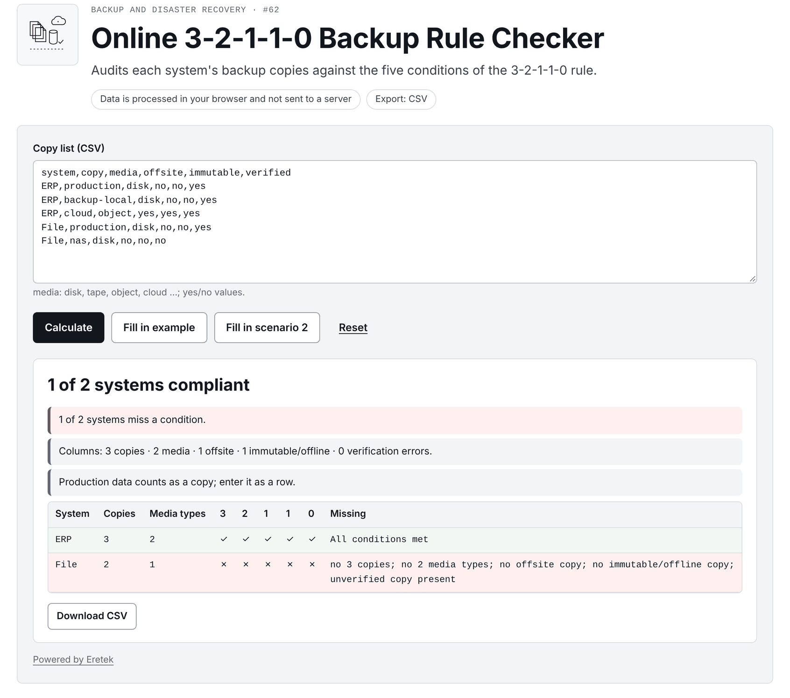

# 3-2-1-1-0 Backup Rule Checker

Check copy count, different media, offsite, immutable/offline copy and error-free verification (3-2-1-1-0) per system from a CSV.

## Try it live

- [Türkçe](https://sistem.eretek.com/araclar/3-2-1-1-0-yedekleme-kontrolu)
- [English](https://sistem.eretek.com/en/tools/3-2-1-1-0-backup-checker)
- [Deutsch](https://sistem.eretek.com/de/werkzeuge/3-2-1-1-0-backup-pruefung)



## What it does

Audits each system's backup copies against the five conditions of the 3-2-1-1-0 rule.

3-2-1-1-0: at least 3 copies (including production), 2 different media types, 1 offsite, 1 immutable or offline and 0 verification errors. Many organizations that 'have backups' on paper fail the last two conditions in a ransomware event. The tool names the missing condition for each system.

## Where it helps

Close missing conditions by system criticality; size immutable copies with the Immutable tool. Verify with a real restore at least once a year.

## How to use it

1. CSV header: `system, copy, media, offsite, immutable, verified`. Add production data as a row.
2. Enter yes/no (evet/hayır, ja/nein) in offsite/immutable/verified; verified = last restore test without errors.
3. Press Calculate; download the result as CSV.

### Fields

| Field | Description |
|---|---|
| Copy list (CSV) | media: disk, tape, object, cloud …; yes/no values. |

## Example input

Press **Fill in example** in the tool to load this input.

**Copy list (CSV)**

```text
system,copy,media,offsite,immutable,verified
ERP,production,disk,no,no,yes
ERP,backup-local,disk,no,no,yes
ERP,cloud,object,yes,yes,yes
File,production,disk,no,no,yes
File,nas,disk,no,no,no
```

**Expected result:** ERP meets all five conditions; File has 2 copies, one media type, no offsite/immutable copy and an unverified NAS copy.

## Method and assumptions

3: rows ≥ 3. 2: distinct media values ≥ 2. 1: at least one row with offsite = yes. 1: at least one row with immutable = yes. 0: verified = yes on all rows.

## Limits and common mistakes

- Common failure points such as all copies managed by the same backup software or credentials are not evaluated.

## Run it locally

The tool is plain HTML, CSS and JavaScript with no build step and no dependencies.

```bash
git clone https://github.com/eretek/3-2-1-1-0-backup-checker.git
cd 3-2-1-1-0-backup-checker
node scripts/serve.js        # or: python3 -m http.server 8080
```

Open <http://127.0.0.1:8080/>. Add `?lang=tr` or `?lang=de` for Turkish or German; without it the page follows the browser language and falls back to English. You can also open `index.html` directly from disk.

Run the tests (Node.js 18 or later):

```bash
node test/run.js    # or: npm test
```

The tests run the tool's own fixtures and the worked examples in all three languages without a browser.

## How it works

All processing happens in your browser. The tool makes no network requests, uses no cookies or browser storage, and does not upload files you select.

No server-side component is needed. The version on the Eretek website renders the same page through a private WordPress plugin; that plugin only produces the page markup and is not part of this repository.

| Path | Purpose |
|---|---|
| `index.html` | Page shell |
| `src/app.js` | Builds the page in Turkish, English or German from `src/data.js` |
| `src/data.js` | Field definitions, examples and all texts in three languages |
| `src/core.js` | Shared runtime: validation, number formats, result rendering, CSV/ICS export |
| `src/tool.js` | The calculation or analysis for this tool |
| `docs/screenshot.png` | Screenshot used in this README |
| `src/tools.css`, `src/page.css` | Styles |
| `test/run.js`, `test/cases.json` | Headless tests |

## License and attribution

This tool is released under the [Eretek Website Attribution License](LICENSE). You may use, modify and redistribute it, including commercially. If you make it available on a website or web application, show a visible, clickable credit linking to https://eretek.com/ on every page where the tool is available, for example:

```html
<a href="https://eretek.com/">Powered by Eretek</a>
```

You may add `rel="nofollow"` to the link. Keep the copyright notice and license text in copies and redistributions.
